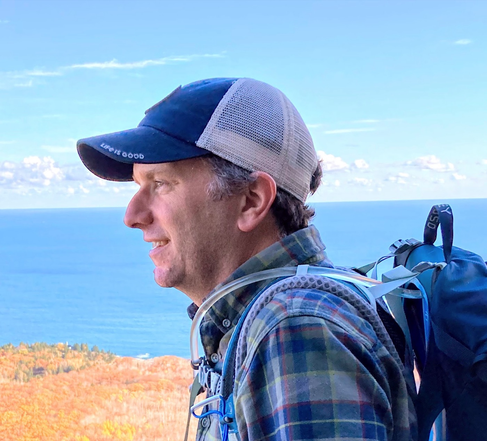
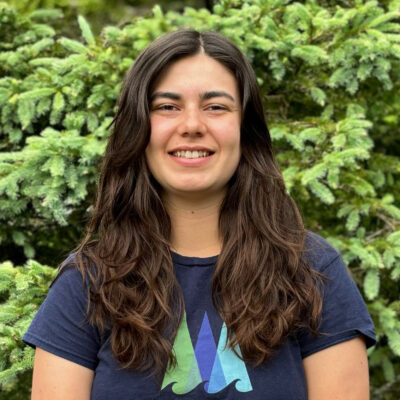
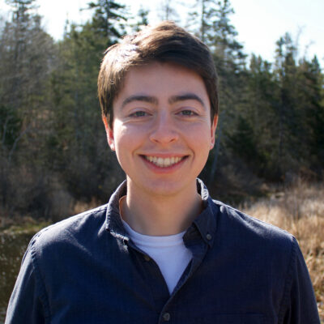
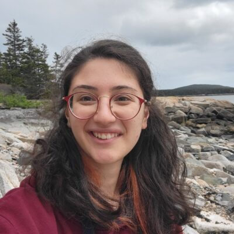

<!--
  ABOUT
  Edit the text freely. The ::: lines mark page sections; leave them in place.
  Buttons are links followed by {.button} (filled) or {.button .outline} (outlined).
  A button whose address isn't known yet is written as [Email [address to confirm]]{.button .todo}
  When you have the address, change it to [Email](mailto:you@example.org){.button}
-->

::: about-intro
{style="object-position: 40% center"}

::: about-text
[About]{.eyebrow}

# Hi, I'm Chris.

I'm a restoration and quantitative ecologist and a Senior Scientist at Schoodic Institute at Acadia National Park. I work alongside park managers, partners, and community scientists to make every conservation action a chance to learn, turning restorations into experiments that show how to help ecosystems adapt to climate change.

My path here has been a winding one, and I'm grateful for every turn. It gave me a toolkit that spans field ecology, statistics, and telling the story of science to anyone who will listen.

[View CV](/cv.qmd){.button} [Get in touch](#contact){.button .outline}
:::
:::

::: {.band .path}
## The path here

From wildlife technician to climate adaptation scientist, by way of marsh birds, puddles, and mountaintops.

::: timeline
::: step
1997 – 2001

### Ontario

Fish and wildlife technician training and early field jobs, from rabies research to Ducks Unlimited.
:::

::: step
2002 – 2011

### University of Arizona

Wildlife biologist and crew leader studying marsh birds and burrowing owls, and learning how to count what's hard to see.
:::

::: step
2011 – 2014

### Cornell University

M.S. on managing species of conservation need in the face of climate change.
:::

::: step
2014 – 2022

### UConn and Northeastern

Ph.D. on fine-scale climates and evolution, then Smith and NSF fellowships testing climate adaptation strategies.
:::

::: {.step .now}
2022 – now

### Schoodic Institute

Senior Scientist at Acadia National Park, putting science into action on summits, wetlands, and forests.
:::
:::
:::

::::: {#team .team .wrap}
## The team

:::: people
::: person

### Amina Wilson

Research Associate
:::

::: person

### Kyle Lima

Forest and Wildlife Ecologist
:::

::: person

### Jenny Kafas

Data Visualization Specialist
:::
::::

::: crew
**Field crew.** Each season, multiple restoration research technicians and interns brave the heat and mosquitoes to collect the data.
:::
:::::

::: {#partners .partners .wrap}
## Partners

Much of my work is done through **Wild Acadia**, a partnership between the National Park Service, Friends of Acadia, and Schoodic Institute.

We also work with:

- College of the Atlantic
- Earthwatch
- Maine Coast Heritage Trust
- Northeast Climate Adaptation Science Center
- University of Maine
- US Fish and Wildlife Service
:::

<!-- MENTORING SECTION: hidden for now (2026-11-13). To bring it back, delete this
     comment's first line and its last line (the one with the arrow), fill in the
     mentoring sentence and the openings, and put a real link on "See Openings".

::: {.mentoring .wrap}
::: mentoring-text
## Mentoring and opportunities

Much of this work is done by early-career scientists: research associates, fellows, field technicians, and interns. Former mentees have gone on to graduate programs, an NSF Graduate Research Fellowship, and careers with the National Park Service, U.S. Fish and Wildlife Service, and U.S. Geological Survey.

One or two sentences on your mentoring approach.
:::

::: join
[Join us]{.eyebrow}

Current openings, e.g., a postdoc position

Positions are posted on the Schoodic Institute jobs page. If you're interested in working together, reach out.

[See Openings →](https://LINK-TO-OPENINGS)
:::
:::
-->

::: {#contact .band .contact}
::: contact-text
## Get in touch

For collaborations, speaking invitations, or media requests.
:::

::: buttons
[Email](mailto:cnadeau@schoodicinstitute.org){.button} [ORCID](https://orcid.org/0000-0002-3568-0793){.button .outline} [Google Scholar](https://scholar.google.com/citations?user=ZDM7wgYAAAAJ&hl=en){.button .outline}
:::
:::
