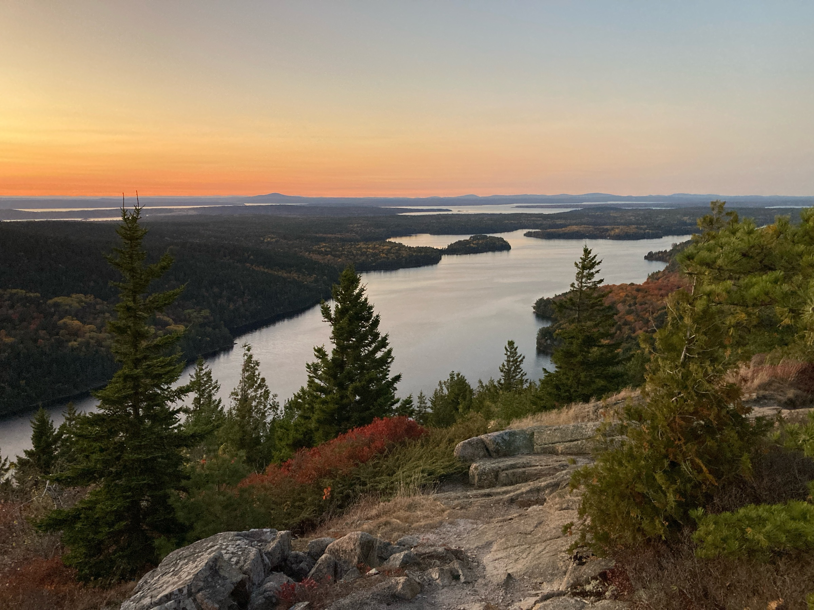

```{=html}
<!--
  HOMEPAGE
  Edit the text below freely. The ::: lines mark page sections; leave them in place.
  Photos: . The credit is added
  automatically from photo_credits.csv.
-->
```

:::: hero
{style="object-position: center 60%"}

::: hero-text
[Climate Change Adaptation · Restoration · Quantitative Ecology]{.hero-label}

# Science in Action

Working together to track change, test solutions, and learn from every conservation action.
:::
::::

::: why
Ecosystems are changing faster than we can study them. We can't afford to wait for perfect answers.
:::

:::: {.research .wrap}
::: section-head
## Research {#research}
:::

<!-- The team sentence lives in research/_team-line.qmd and the three research tiles in
     research/_tiles.qmd (both shared with the Research page) -->




::::

::::::: band
## How we work

:::::: cols
::: col
### Science together

Questions are shaped with park managers, partners, and community scientists who put the answers to work.
:::

::: col
### Rigorous numbers

Models and statistics that turn messy field data into answers managers can trust.
:::
::::::
:::::::

::::: {.news .wrap}
:::: section-head
::: {}
[News]{.eyebrow}

## Updates & in the news
:::

[All News →](/news.qmd)
::::

<!-- These cards come from data/news.yml: the items with "featured: 1", "featured: 2", "featured: 3" -->


:::::
