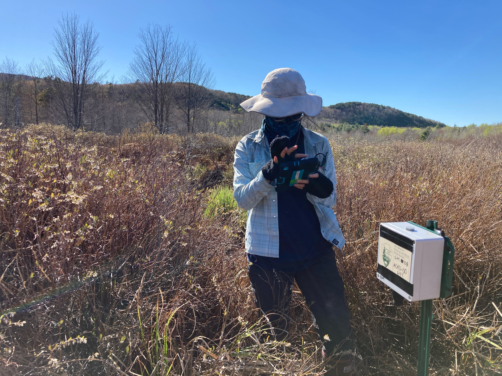
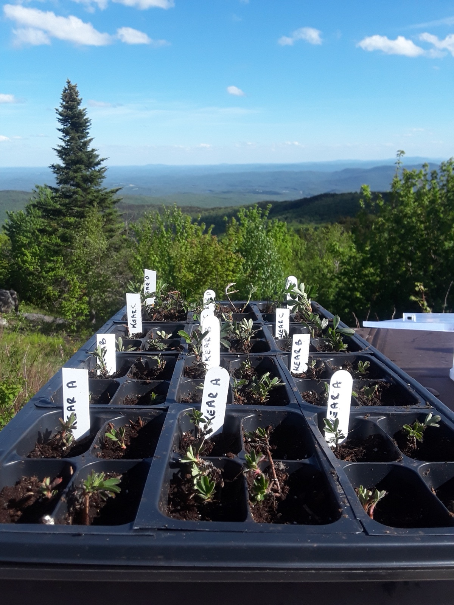
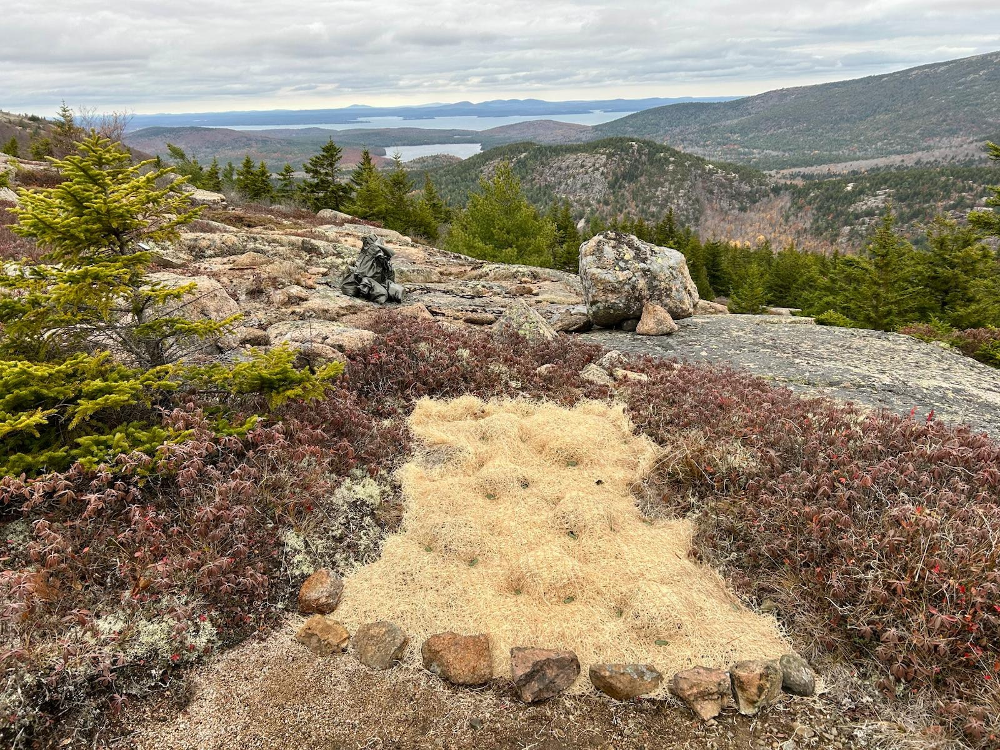

<!--
  The three research tiles. Shown on the homepage and on the Research page.
  Each tile: photo, number, title (links to the theme page), question + sentence, "Explore →".
-->

::: tiles
::: tile

[01]{.tile-num}

### [Tracking Change](/research/tracking-change.qmd){.stretched-link}

**What's changing, and why?** We use decades-old surveys and new technology to find out.

[Explore →]{.explore}
:::

::: tile

[02]{.tile-num}

### [Testing Solutions](/research/testing-solutions.qmd){.stretched-link}

**Which climate change adaptation strategies actually work?** We test them first with small-scale experiments.

[Explore →]{.explore}
:::

::: tile

[03]{.tile-num}

### [Learning While Doing](/research/learning-while-doing.qmd){.stretched-link}

**How do we put answers to work?** We build experiments into restoration on Acadia's summits and wetlands, learning as we go.

[Explore →]{.explore}
:::
:::
