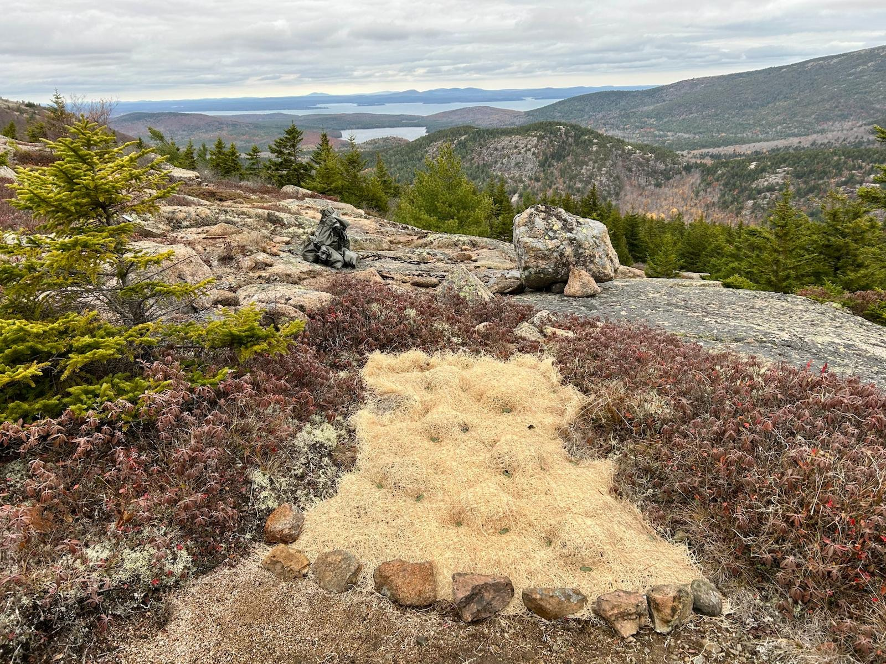
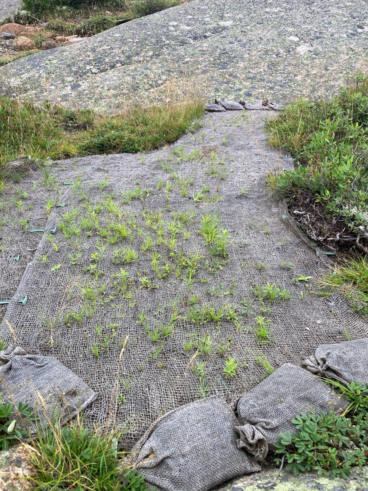
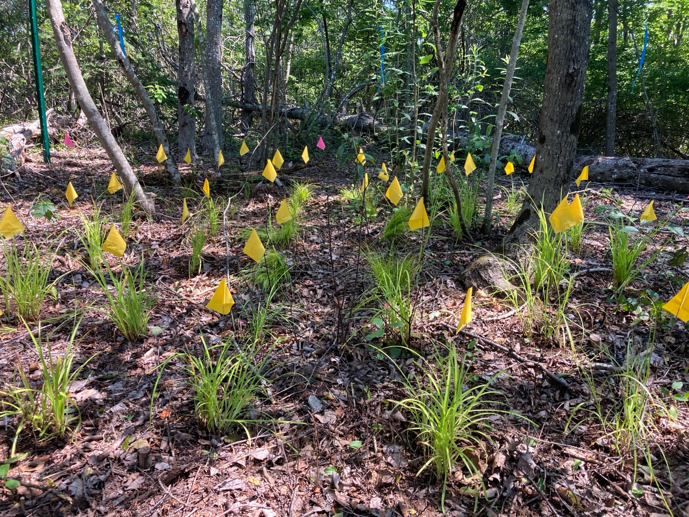

<!--
  RESEARCH PAGE: LEARNING WHILE DOING
  Edit the text freely. The ::: lines mark page sections; leave them in place.

  Each ::: project block:
    - the photo (or a line starting "Photo needed · ..." if there isn't one yet)
    - ## Title
    - the description
    - a list of links. A link without its address yet is plain text, e.g.
        - Portland Press Herald story [URL] →
      When you have the address, make it a link:
        - [Portland Press Herald story →](https://...)
    - Partners: ...
  Projects are numbered and alternate sides automatically.
-->

::: {.hero .theme-hero}
{style="object-position: center 65%"}

::: hero-text
[03 · Research]{.hero-label}

# Learning While Doing

How do we put answers to work?
:::
:::

::: overview
Small-scale experiments can only take us so far. To learn what works at the management scale, we [build experiments into restoration itself](https://doi.org/10.1016/j.biocon.2023.110374), an approach known as active adaptive management. With the National Park Service and partners, we try several methods at once, so the work gets done now and each project shows how to do the next one better.
:::

::: {.projects .wrap}

::: project

## Summit restoration

Decades of trampling stripped soil and plants from the summits of Acadia National Park, and heavier rains could make it worse. Active restoration began in 2015, with experiments built into each phase. The first phase showed that soil is key. The second phase mimics nature: we're testing new soil and seed mixes, adding small mounds, and recreating the leaf litter layer, on plots built with soil hiked up by Save Our Summits volunteers.

- [Soil and Summit Restoration (2025) →](https://doi.org/10.1111/avsc.70034)
- [Soil Is Key →](https://schoodicinstitute.org/soil-is-key/)
- [Summit Restoration Is in the Bag →](https://friendsofacadia.org/restoration-projects/summit-restoration-save-our-summits/)
- [Sea to Trees Podcast: The Mountain Summit →](https://schoodicinstitute.org/sea-to-trees-season-4-episode-2/)

Partners: Friends of Acadia · National Park Service
:::

::: project

## Can native plants keep buckthorn out?

The park's invasive plant team invests more than 1,000 hours a year pulling, cutting, and treating invasive shrubs at more than 100 sites, yet glossy buckthorn re-establishes quickly. With that team, we turned removal into an experiment: after clearing buckthorn at two wetland sites, crews planted native shrubs or native grasses side by side. Early results are encouraging: native shrubs cut buckthorn reinvasion or seed germination by about 40%, depending on the site, while grasses had no effect. We're working out how to restore native shrubs cost-effectively.

- [Friends of Acadia Project →](https://friendsofacadia.org/restoration-projects/experiment-native-plants-glossy-buckthorn/)
- [Expanding the Management Toolbox →](https://schoodicinstitute.org/expanding-the-management-toolbox-for-glossy-buckthorn-in-acadia/)

Partners: Friends of Acadia · National Park Service
:::

:::

::: next
[Back to the beginning]{.eyebrow}

[Tracking Change →](/research/tracking-change.qmd){.stretched-link}

What's changing, and why?
:::
