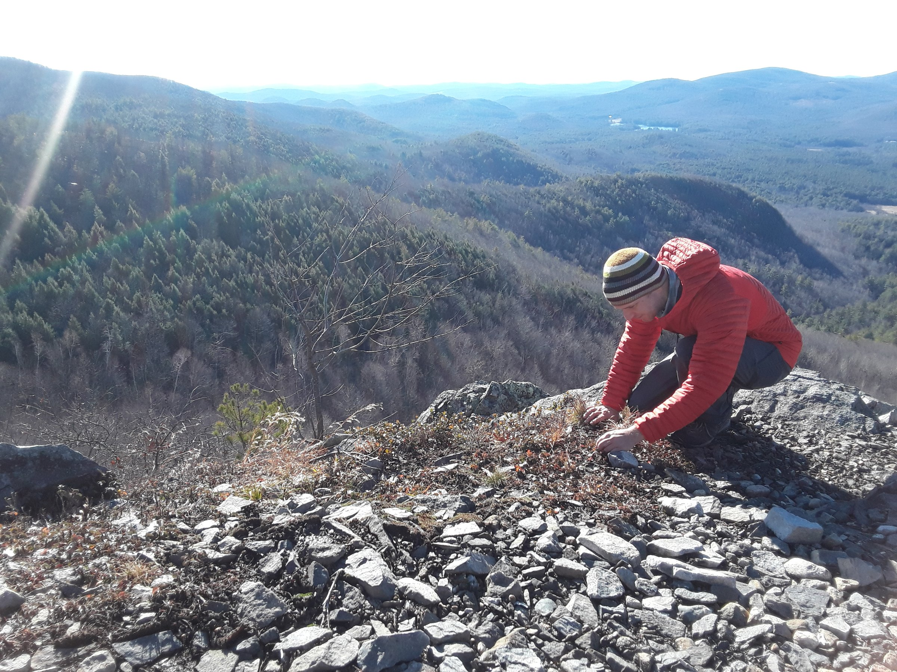
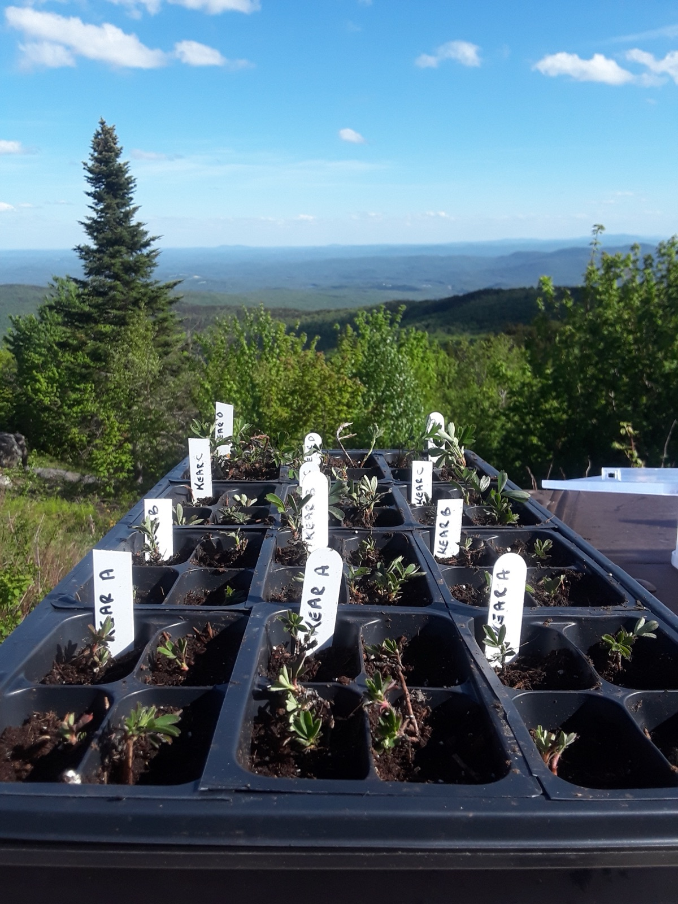
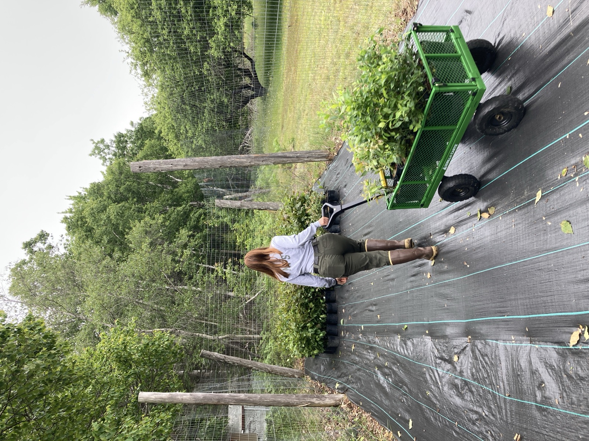
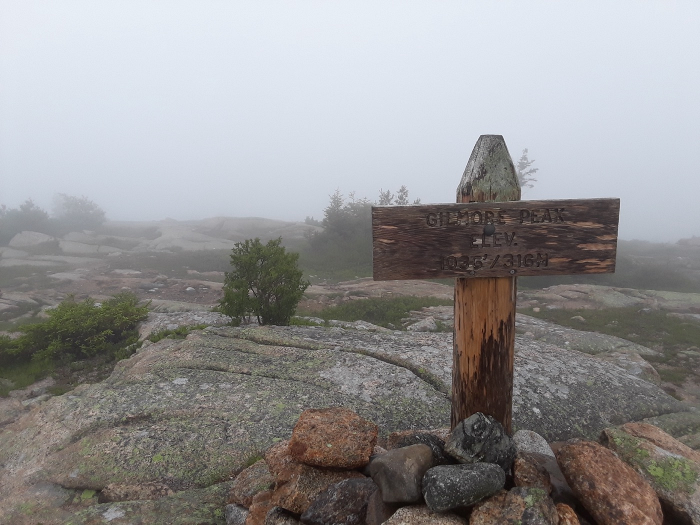

<!--
  RESEARCH PAGE: TESTING SOLUTIONS
  Edit the text freely. The ::: lines mark page sections; leave them in place.

  Each ::: project block:
    - the photo (or a line starting "Photo needed · ..." if there isn't one yet)
    - ## Title
    - the description
    - a list of links. A link without its address yet is plain text, e.g.
        - Portland Press Herald story [URL] →
      When you have the address, make it a link:
        - [Portland Press Herald story →](https://...)
    - Partners: ...
  Projects are numbered and alternate sides automatically.
-->

::: {.hero .theme-hero}
{style="object-position: center 40%"}

::: hero-text
[02 · Research]{.hero-label}

# Testing Solutions

Which climate change adaptation strategies actually work?
:::
:::

::: overview
Once we know what's changing, we need to know what to do about it. Many climate change adaptation strategies have been recommended, but few have been tested. Some hold great promise but also carry real risk. We use small-scale experiments and test model predictions on the ground to show what works, what doesn't, and what surprises might be waiting.
:::

::: {.projects .wrap}

::: project

## Assisted gene flow with three-toothed cinquefoil

Assisted gene flow moves plants between populations of the same species, adding genetic diversity or warm-adapted genes that could help them keep pace with climate change. It's one of the most frequently recommended adaptation strategies. We're testing it with three-toothed cinquefoil, a temperature-sensitive summit plant, by mixing local plants with ones from warmer or similar climates. So far, surprisingly, mixing hasn't helped plants cope with heat stress. We're studying their DNA to learn why.

- [Learning to Restore Mountains →](https://www.nps.gov/articles/000/nadeau_summits.htm)
- [Acadia as a Lab →](https://www.sierraclub.org/sierra/2024-4-winter/feature/acadia-national-park-laboratory-climate-change-mitigation-efforts)

Partners: National Park Service
:::

::: project
{style="object-position: center 60%"}

## Assisted migration of trees and shrubs

Assisted migration means moving species to places where the future climate may suit them better, such as bringing trees and shrubs from farther south to help coastal Maine forests adapt to warming. Most experiments judge success by whether transplants survive and grow. But surviving isn't the same as belonging. In experimental plantings, we measure success by ecosystem function: whether southern trees host the same insects as native trees, and whether southern shrubs compete better against invasive shrubs.

Partners: Maine Coast Heritage Trust · National Park Service · Northeast Climate Adaptation Science Center · University of Maine
:::

::: project

## Where can summit plants hold on?

Climate change refugia are places where species may hold on as the climate changes, and protecting them is a common adaptation strategy. Collaborators have mapped likely refugia for summit plants like three-toothed cinquefoil and black crowberry, and we're modeling rare species like boreal blueberry. But a map is only a prediction. With Earthwatch Institute volunteers, we track summit plants at the southern edge of their range to test whether populations in predicted refugia are faring better.

- [Acadia Offers Refuge from a Changing Climate →](https://schoodicinstitute.org/acadia-offers-refuge-from-a-changing-climate/)
- [Climate Refugia (USGS Video) →](https://www.usgs.gov/media/videos/climate-refugia-a-buffer-climate-change)

Partners: College of the Atlantic · Earthwatch Institute · National Park Service · Northeast Climate Adaptation Science Center · US Fish and Wildlife Service
:::

:::

::: next
[Next]{.eyebrow}

[Learning While Doing →](/research/learning-while-doing.qmd){.stretched-link}

How do we put answers to work?
:::
