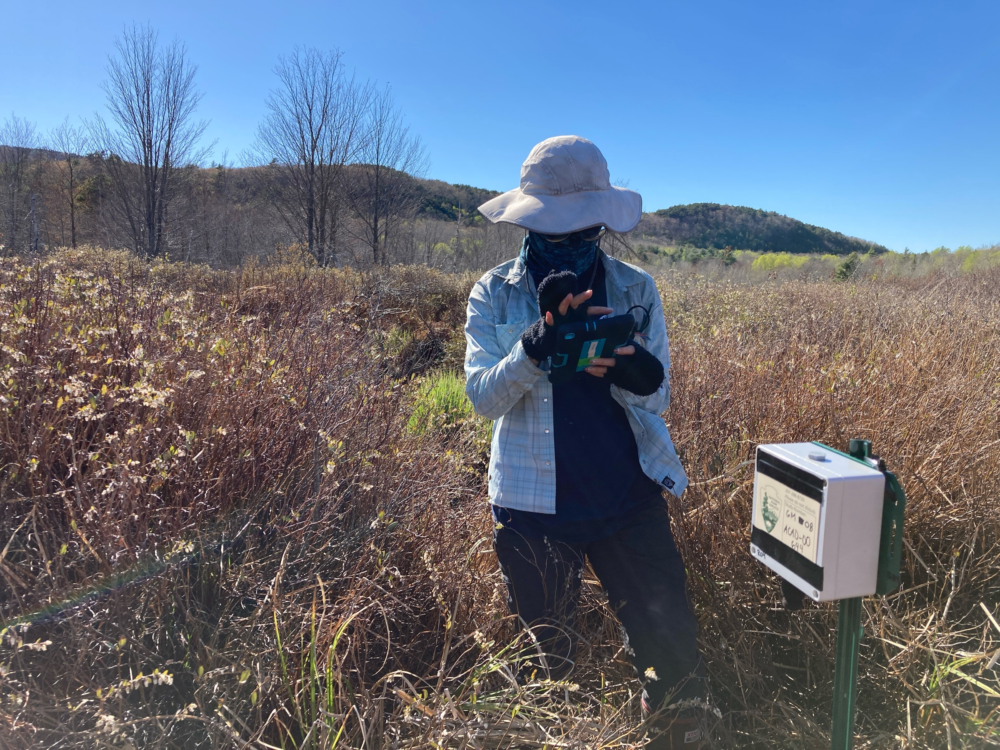
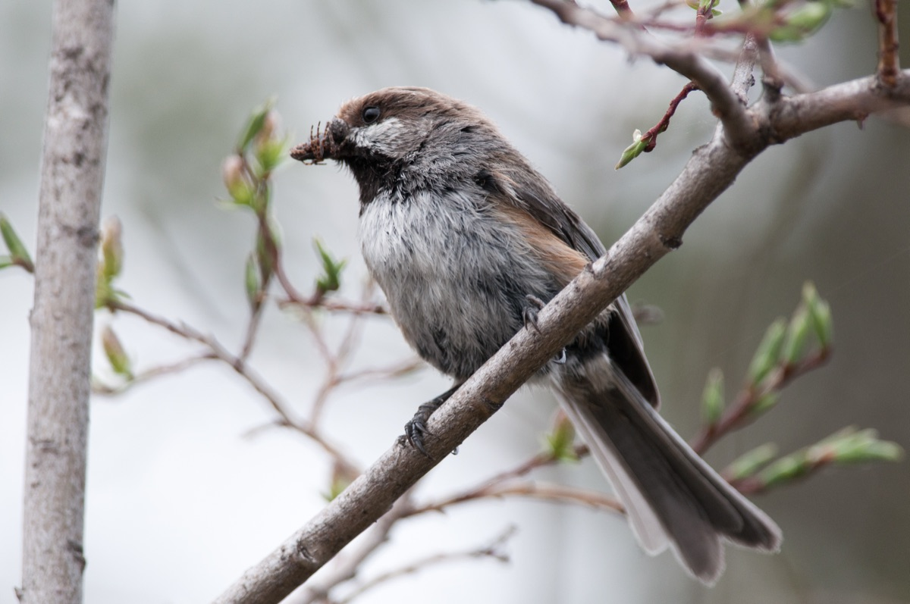
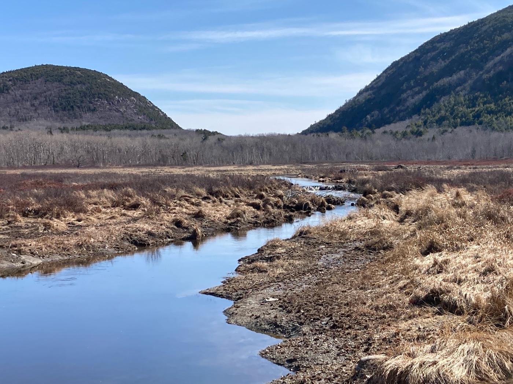
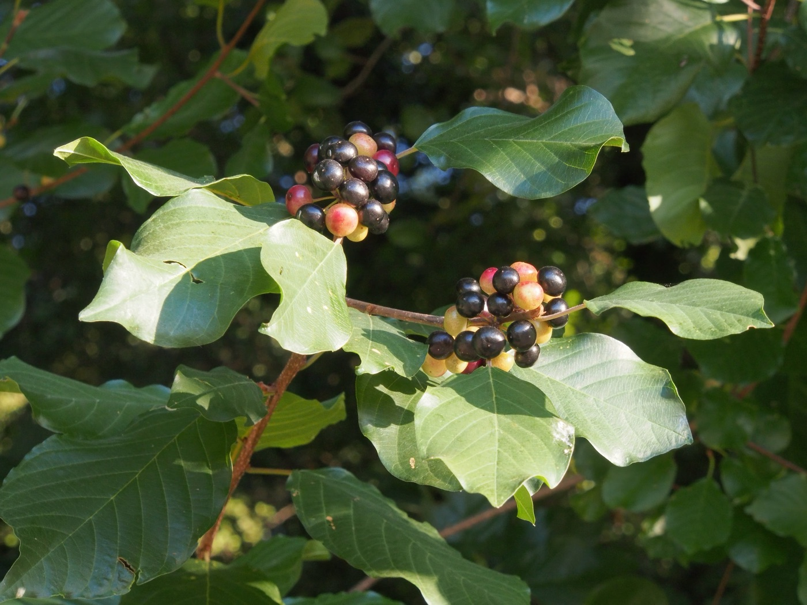

<!--
  RESEARCH PAGE: TRACKING CHANGE
  Edit the text freely. The ::: lines mark page sections; leave them in place.

  Each ::: project block:
    - the photo
    - ## Title
    - the description
    - a list of links.
    - Partners: ...
  Projects are numbered and alternate sides automatically.
-->

::: {.hero .theme-hero}
{style="object-position: center 35%"}

::: hero-text
[01 · Research]{.hero-label}

# Tracking Change

What's changing, and why?
:::
:::

::: overview
Forests and wetlands in the Northeastern US are changing rapidly. We pair historical surveys and long-term monitoring with new tools, from acoustic recorders and AI to drones and real-time sensors, to measure how ecosystems are shifting and to understand why. The why is what tells us how to act.
:::

::: {.projects .wrap}

::: project

## Revisiting historical bird surveys

Birders have studied the region surrounding Acadia National Park for decades, and they left detailed records for us to follow. By repeating their surveys from 1959 and the 1990s, we've found fewer birds and shifting communities. Now we're asking why, so managers know what can be done.

- [Listening to the Coastal Forest →](https://schoodicinstitute.org/listening-to-the-coastal-forest/)
- [Where Are the Songbirds? →](https://www.pressherald.com/2026/05/17/where-are-the-songbirds-as-climate-shifts-acadias-forests-are-getting-quieter/)

Partners: National Park Service · University of Maine
:::

::: project

## Is wetland restoration working?

The Great Meadow is one of Acadia's most iconic views, and one of its most altered wetlands. More than a decade of water and vegetation data, gathered by park and partner scientists, guided recent changes to culverts and trails to restore natural water flow and handle heavier rainstorms. We compare conditions before and after those changes to learn whether the wetland is recovering, tracking water, plants, birds, and beavers with tools that make monitoring more efficient.

- [Data Behind the Decisions →](https://schoodicinstitute.org/great-meadow-restoration/)
- [Acadia's Largest Restoration →](https://www.bangordailynews.com/2026/06/14/hancock/hancock-environment/acadia-tackles-climate-change-largest-restoration-project-joam40zk0w/)

Partners: Friends of Acadia · National Park Service
:::

::: project

## Tracking invasive shrubs

Invasive shrubs are one of the most costly management problems in the Northeastern US. Our monitoring shows that after removal, invasive shrubs come back, but native shrubs rarely do. Timing may be part of the reason. Like researchers elsewhere, we've found that invasive shrubs leaf out earlier and hold their leaves later than native shrubs, adding weeks to their growing season. The open question is whether invasives respond more readily to warm springs and falls, an edge that could grow as the climate changes.

Partners: Friends of Acadia · National Park Service
:::

:::

::: next
[Next]{.eyebrow}

[Testing Solutions →](/research/testing-solutions.qmd){.stretched-link}

Which climate change adaptation strategies actually work?
:::
